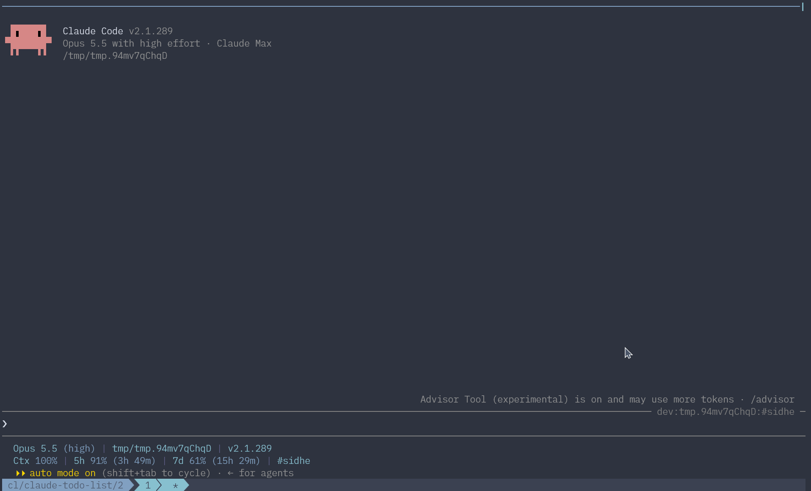

# Claude Todo List

[](https://github.com/cldotdev/claude-todo-list/actions/workflows/ci.yml)

English | [繁體中文](README.zh-TW.md)

A [Claude Code](https://code.claude.com) mod that lists a conversation's open items in a band above the prompt until they are settled, so decisions and follow-ups do not get lost in long sessions.



## Installation

Requires Claude Code with mod support (>= 2.1.304).

```bash
claude plugin marketplace add cldotdev/claude-todo-list
claude plugin install todo-list@claude-todo-list
```

## Usage

### The `/todos` Command

| Command | Effect |
| --- | --- |
| `/todos` | Lists the open items with their details. |
| `/todos pane` | Opens [the pane](#the-pane). From an empty prompt it also gives the pane the keys, even when it is already open. `/todos pane <text>` sends `pane <text>` as a prompt. |
| `/todos refresh` | Reviews each item against the whole conversation: removes closed items, adds missing ones, and refreshes details. Kept items keep their titles. |
| `/todos delete <numbers>` | Deletes items by number, such as `2`, `1-3`, or `1,4 6`. A number past the end cancels the whole delete. |
| `/todos clear` | Deletes every item. The items go to the trash as your deletions. |
| `/todos trash` | Lists removed items, newest first, with their details and who removed each. |
| `/todos restore <numbers>` | Puts trash items back on the list, numbered as `/todos trash` shows them. A number past the end cancels the whole restore. |
| `/todos purge <numbers>` | Removes trash entries for good, numbered the same way. Purging an item you deleted lets the model add it back. |
| `/todos reset` | Empties the list and the trash, which lifts every never-add-back block. |
| `/todos <prompt>` | Sends the prompt with every item quoted and numbered above it, so it can say "do 1 and 2, skip 3". |

### The Band

The band shows the numbered list while it has items and the pane is closed. It holds as many items as fit in the rows Claude Code gives it, up to [`band_max_items`](#configuration), so a long draft shrinks the window instead of scrolling the band. A dim `<n> more` line counts the items after the window. Focusing the band lengthens its help line, which can drop one item from a squeezed window. Leaving the band returns the window to the top.

| Key | Action |
| --- | --- |
| `Ctrl+X Tab` | Focus the band. |
| `j`/`k`, `Tab`/`Shift+Tab` | Move to the next or previous item. |
| `s` | Select or unselect the focused item. |
| `a` | Select every item, or clear the selection when all are selected. |
| `n`/`p` | Page the window down or up; the focus keeps its row. Does nothing in the detail view or when the window cannot move. |
| `v` | Paste the selected items, or else the focused item, into the prompt box, quoted with their numbers. |
| `o`/`Enter` | Show the focused item's detail, or go back to the list. |
| `t` | Switch to the pane. |
| `b` | Ask `/btw` about the focused item. While Claude is working, the answer waits for the turn to end. |
| `d` | Delete the focused item; a second `d` confirms and `Esc` cancels. |
| `Esc` | Return to the prompt, or from the detail view to the list. |

### The Pane

The pane lists the items beside the transcript, floor to ceiling in fullscreen from 110 columns, so a long prompt does not squeeze it. Titles wrap instead of being cut, the window has no item cap, and a dim `<n> more` line counts the items after it. While the pane is open, the band is not drawn.

- **Open**: `t` on the band or `/todos pane`. After `t`, press `Ctrl+X Tab` to give the pane the keys. It opens on its own only through [`default_view`](#configuration).
- **Close**: `t` on the pane, `Ctrl+X X`, or its close mark closes it and clears its focus, selection, and expanded detail. `Esc` only hands the keys back to the prompt box. `/clear` empties its state but leaves it open.
- **Keys**: the same as the band, except that `t` goes back to the band and `o`/`Enter` expands the focused item's detail under its row. One item expands at a time, following the focus, and a second `o` collapses it.
- **State**: focus, expanded detail, selection, armed delete, and window are the pane's own; typing, sending a prompt, and `Esc` do not reset them. A successful `v` clears the selection. Without the keys, the pane hides the focus dot but keeps the focus, and names `Ctrl+X Tab` in its help line. When anything but the pane's own delete removes an item, the focus moves to the item now at that position.

## Configuration

Change these settings in `/config`, where each one shows as `todo-list.<setting>`.

| Setting | Values | Default | Takes effect |
| --- | --- | --- | --- |
| `default_view` | `band`, `pane` | `band` | At the next session start |
| `language` | A language, such as `English` or `zh-TW` | Empty | On the next turn |
| `band_max_items` | `1` to `10` | `5` | On the next draw |

- **`default_view`**: the view a new or resumed session starts in, also with an empty list. A pane opened this way takes no keys, so typing still goes to the prompt box. A hot reload of the mod and `/clear` do not apply it again, and `t` switches views at once. The pane needs a terminal 144 columns wide, or 110 once you have opened it by hand; otherwise the band stays.
- **`language`**: the language of item titles and details. When empty, Claude Code's `language` setting applies, then the language the agent answers in. Existing items keep their language; `/todos reset` starts over.
- **`band_max_items`**: the most items the band shows. It does not limit the pane. A value outside 1 to 10 written into `settings.json` by hand counts as 5, even though `/config` shows it as written.

The mod also reads Claude Code's `cleanupPeriodDays` setting (30 by default): a saved list unchanged for more days than that is dropped. An invalid value keeps saved lists.

## How It Works

- **Updates**: after each main-loop turn that ends with an answer, the mod asks Sonnet (the `sonnet` alias, which follows the installed Claude Code version) which items the turn resolved and opened. Subagent turns do not count.
- **Open items**: work someone deferred, a follow-up or check the agent promised, or an unsettled question or decision. The step in progress, anything finished within the same turn, and tasks in an OpenSpec `tasks.md` stay off the list. Each item has a one-line title and a short detail.
- **Reviews**: a review removes items that are no longer open, including ones a later turn made moot without naming them. It runs over the recent turns after 8 answered turns, or after 3 when the list holds 6 or more items, and never adds items.
- **Trash**: items that leave the list go to a trash with their title, detail, remover (you or the model), and time, keeping each remover's newest 99. Items you removed are never added back; items the model removed come back only if the conversation reopens them.
- **Storage**: lists are kept per session and come back on resume. When all saved lists pass 80% of the mod's 4 MiB store, the ones unchanged the longest are dropped until they are back at 80%, never the current session's. A toast reports a failed save once per session. `/clear` empties the list and the trash.
- **Cost**: each answered turn costs one extra Sonnet call, and a review one more, at most every 3 turns. `/todos refresh` forks the main conversation, so it runs on the main model with the whole context. Right after a resume there is nothing to fork, so it rebuilds the list from the transcript on the main model without the prompt cache, which costs more. The transcript holds the newest 200,000 characters, with each tool result cut to 2,000.

## Development

| Path | Contents |
| --- | --- |
| `hooks/register.tsx` | Event hooks, the `/todos` command, the band, and the pane. |
| `hooks/list.ts` | Model prompts, reply parsing, and window arithmetic. |
| `hooks/store.ts` | Store keys and the arithmetic that keeps the store under its size cap. |
| `types/index.d.ts` | The mod's state contract. |
| `tests/` | Tests run by `claude plugin test`. |

```bash
claude plugin validate .
claude plugin test .
scripts/test-min-version.sh
```

`scripts/test-min-version.sh` runs the strict validation and the tests through `npx` on the oldest supported Claude Code version, the one CI pins. The first run downloads it.

To try local changes, load the clone for one session. It replaces an installed `todo-list@claude-todo-list` for that session:

```bash
claude --plugin-dir /path/to/claude-todo-list
```

## License

[MIT](LICENSE)
