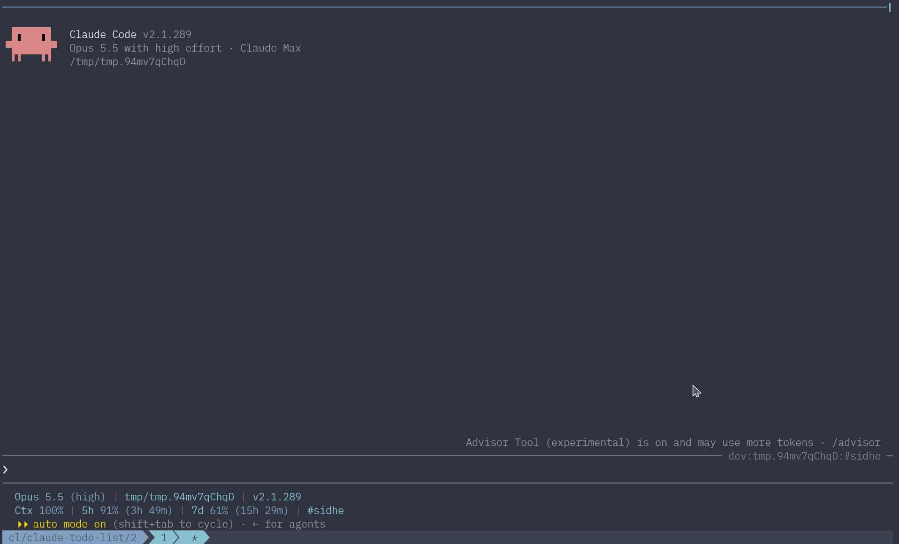

# Claude Todo List

[](https://github.com/cldotdev/claude-todo-list/actions/workflows/ci.yml)

English | [繁體中文](README.zh-TW.md)

A [Claude Code](https://code.claude.com) mod that keeps a running list of the open items in a conversation and shows it in a band above the prompt.

Long sessions leave decisions, promised follow-ups, and unanswered questions far back in the conversation, where they are easy to drop. The mod collects them as the conversation goes, so they stay in sight until they are settled.



## How It Works

- After each main-loop turn that ends with an answer, the mod sends the turn to Sonnet (the `sonnet` alias, so the model follows the installed Claude Code version) and asks which current items the turn resolved and which new ones it opened. Subagent turns do not count.
- An open item is work someone deferred, a follow-up or check the agent promised, or a question or decision that is not settled yet. The step being carried out right now, anything finished within the same turn, and tasks already listed in an OpenSpec `tasks.md` stay off the list.
- Each item has a one-line title and a short detail, written in the language the agent answers in.
- The list is kept per session and comes back when the session is resumed. A saved list left unchanged for longer than `cleanupPeriodDays`, the setting for how long Claude Code keeps transcripts (30 days by default), is dropped. `/clear` empties the list and the trash.
- Every item that leaves the list goes to a trash with its title, its detail, who removed it (you or the model), and when. Each source keeps its newest 99 entries. Items you removed are never added back; items the model removed are not added back unless the conversation reopens them.
- An item that a later turn made moot has no turn of its own to remove it, so a review also runs over the recent turns: after 8 answered turns, or after 3 when the list holds 6 or more items. It only removes items that are no longer open; it never adds any. Removed items can be brought back with `/todos restore`.

Each answered turn costs one extra Sonnet call, and a review adds one more, at most one every 3 turns. `/todos refresh` forks the main conversation, so it runs on the main model with the whole context. It reviews each item on the list against that context: it removes the ones that are no longer open, adds missing ones, and may rewrite a kept item's detail, while every kept item keeps its title. Right after a resume there is nothing to fork yet, so it rebuilds the list from the transcript instead, on the main model without the prompt cache, which costs more. The transcript holds the newest 200,000 characters of the conversation, with each tool result cut to 2,000.

## Requirements

Claude Code with mod support (>= 2.1.290).

## Installation

Install it from this repository's marketplace:

```bash
claude plugin marketplace add cldotdev/claude-todo-list
claude plugin install todo-list@claude-todo-list
```

## Usage

### The `/todos` Command

| Command | Effect |
| --- | --- |
| `/todos` | Lists the open items with their details. |
| `/todos refresh` | Reviews each item against the whole conversation: removes items that are no longer open, adds missing ones, and refreshes details. |
| `/todos clear` | Deletes every item. The items go to the trash as your deletions. |
| `/todos reset` | Empties the list and the trash, which also lifts every never-add-back block. |
| `/todos trash` | Lists the removed items, newest first, with their details and who removed each. |
| `/todos restore <numbers>` | Puts items from the trash back on the list, numbered as `/todos trash` shows them and written like `delete` numbers. A number past the end of the trash cancels the whole restore. |
| `/todos purge <numbers>` | Removes entries from the trash for good, numbered as `/todos trash` shows them. Purging an item you deleted lets the model add it back. |
| `/todos delete <numbers>` | Deletes items by number, such as `2`, `1-3`, or `1,4 6`. A number past the end of the list cancels the whole delete. |
| `/todos <prompt>` | Sends the prompt with every item quoted and numbered above it, so the prompt can say "do 1 and 2, skip 3". |

### The Band

The band above the prompt shows the numbered list while it has items.

| Key | Action |
| --- | --- |
| `Ctrl+X Tab` | Focus the band. |
| `j`/`k`, `Tab`/`Shift+Tab` | Move to the next or previous item. |
| `s` | Select or unselect the focused item. |
| `a` | Select every item, or clear the selection when every item is already selected. |
| `p` | Paste the selected items, or the focused item when none is selected, into the prompt box. Each is quoted with its number in the band. |
| `o`/`Enter` | Show the focused item's detail, or go back to the list. |
| `b` | Ask `/btw` about the focused item. While Claude is working, the answer waits for the current turn to end. |
| `d` | Delete the focused item; a second `d` confirms and `Esc` cancels. |
| `Esc` | Return to the prompt. The band goes back to the list if it was showing an item's detail. |

## Development

| Path | Contents |
| --- | --- |
| `hooks/register.tsx` | Event hooks, the `/todos` command, and the band. |
| `hooks/list.ts` | Model prompts and reply parsing. |
| `types/index.d.ts` | The mod's state contract. |
| `tests/` | Tests run by `claude plugin test`. |

```bash
claude plugin validate .
claude plugin test .
```

To try local changes, start Claude Code with the clone loaded for that session:

```bash
claude --plugin-dir /path/to/claude-todo-list
```

The clone replaces an installed `todo-list@claude-todo-list` for that session, so there is no need to disable or uninstall it first.

## License

[MIT](LICENSE)
