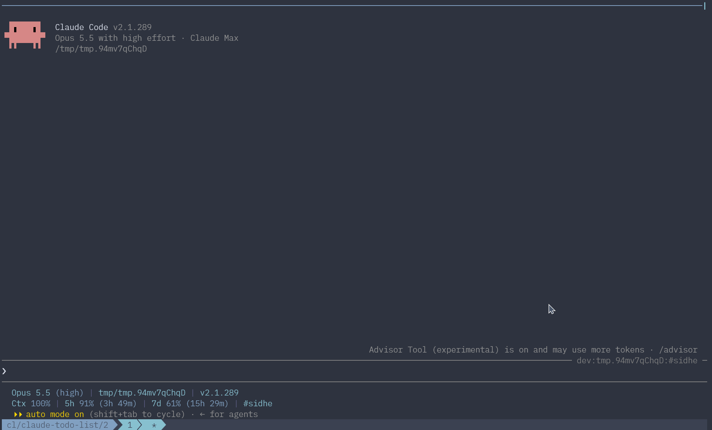

# Claude Todo List

[](https://github.com/cldotdev/claude-todo-list/actions/workflows/ci.yml)

[English](README.md) | 繁體中文

一個 [Claude Code](https://code.claude.com) mod，會把對話中尚未處理的事項列在 prompt 上方的 band，直到處理完為止，避免決定和後續工作埋沒在長對話裡。



## 安裝

需要支援 mod 的 Claude Code (>= 2.1.304)。

```bash
claude plugin marketplace add cldotdev/claude-todo-list
claude plugin install todo-list@claude-todo-list
```

## 使用方式

### `/todos` 指令

| 指令 | 作用 |
| --- | --- |
| `/todos` | 列出待辦事項和說明 |
| `/todos pane` | 開啟 [pane](#pane)。prompt 輸入框是空的時，即使 pane 已經開著，也會把按鍵交給 pane。`/todos pane <文字>` 會把 `pane <文字>` 當成 prompt 送出 |
| `/todos refresh` | 根據整段對話逐項檢查：移除不再待辦的事項、補上漏掉的、更新說明。保留的事項標題不變 |
| `/todos delete <編號>` | 依編號刪除事項，例如 `2`、`1-3` 或 `1,4 6`。只要有一個編號超出範圍，整次刪除就會取消 |
| `/todos clear` | 刪除所有事項，這些事項會記為你刪除的，放進垃圾桶 |
| `/todos trash` | 由新到舊列出被移除的事項、說明和移除者 |
| `/todos restore <編號>` | 把垃圾桶裡的事項放回清單，編號以 `/todos trash` 顯示的為準。只要有一個編號超出範圍，整次還原就會取消 |
| `/todos purge <編號>` | 永久刪除垃圾桶裡的事項，編號的算法相同。永久刪除你刪過的事項後，模型就可以再把它加回來 |
| `/todos reset` | 清空清單和垃圾桶，所有「不再加回來」的限制也一併解除 |
| `/todos <prompt>` | 把所有事項加上編號、引用在 prompt 前面一起送出，prompt 裡就能寫「做 1 和 2，跳過 3」這類指示 |

### Band

清單有事項且 pane 沒有開著時，band 會顯示加上編號的清單。視窗依 Claude Code 分給 band 的列數顯示事項，最多 [`band_max_items`](#設定) 個，所以草稿變長時視窗會縮小，band 不會捲動。暗色的 `<n> more` 標出視窗後面還有幾個事項。band 取得焦點時說明列會變長，擠得很小的視窗可能少一個事項。離開 band 後，視窗會回到最前面。

| 按鍵 | 動作 |
| --- | --- |
| `Ctrl+X Tab` | 把焦點移到 band |
| `j`/`k`、`Tab`/`Shift+Tab` | 移到下一個或上一個事項 |
| `s` | 選取或取消選取焦點所在的事項 |
| `a` | 選取所有事項，全部都已選取時則清除選取 |
| `n`/`p` | 把視窗往下或往上翻一頁，焦點留在同一列。正在顯示事項說明或視窗無法再移動時，不會有動作 |
| `v` | 把已選取的事項貼到 prompt 輸入框並附上編號，沒有選取時改貼焦點所在的事項 |
| `o`/`Enter` | 顯示焦點所在事項的說明，或回到清單 |
| `t` | 切換到 pane |
| `b` | 用 `/btw` 詢問焦點所在的事項，Claude 正在工作時會等這個 turn 結束才回答 |
| `d` | 刪除焦點所在的事項，再按一次 `d` 確認，按 `Esc` 取消 |
| `Esc` | 回到 prompt，正在顯示事項說明時則回到清單 |

### Pane

pane 把事項列在 transcript 旁邊，全螢幕且寬度達 110 欄時會從上到下佔滿，所以長 prompt 不會把它擠小。標題會換行而不會被截斷，視窗沒有事項數量上限，暗色的 `<n> more` 標出後面還有幾個事項。pane 開著時不會畫出 band。

- **開啟**：在 band 上按 `t`，或執行 `/todos pane`。按 `t` 之後，要再按 `Ctrl+X Tab` 才會把按鍵交給 pane。pane 只會因為 [`default_view`](#設定) 自己開啟。
- **關閉**：在 pane 上按 `t`、按 `Ctrl+X X` 或點關閉標記，焦點、選取和展開的說明也會一併清除。`Esc` 只把按鍵還給 prompt 輸入框。`/clear` 會清掉 pane 的狀態，但不會關閉 pane。
- **按鍵**：和 band 相同，只有 `t` 是切回 band，`o`/`Enter` 則把焦點所在事項的說明展開在它的那一列下方。一次只展開一個事項，展開的說明跟著焦點移動，再按一次 `o` 就收合。
- **狀態**：焦點、展開的說明、選取、待確認的刪除和視窗位置都是 pane 自己的，打字、送出 prompt 和按 `Esc` 都不會重設。`v` 貼上成功後會清除選取。沒有按鍵時，pane 不畫焦點圓點但保留焦點，並在說明列提示 `Ctrl+X Tab`。事項因為 pane 自己的刪除以外的原因離開清單時，焦點會移到現在位在同一位置的事項。

## 設定

請在 `/config` 裡變更這些設定，每個設定都顯示為 `todo-list.<設定名稱>`。

| 設定 | 可用值 | 預設值 | 生效時機 |
| --- | --- | --- | --- |
| `default_view` | `band`、`pane` | `band` | 下一次 session 開始時 |
| `language` | 語言名稱，例如 `English` 或 `zh-TW` | 空白 | 下一個 turn |
| `band_max_items` | `1` 到 `10` | `5` | 下一次繪製時 |

- **`default_view`**：新 session 或恢復的 session 一開始使用的檢視，清單是空的也一樣。這樣開啟的 pane 不會取得按鍵，打字仍會進到 prompt 輸入框。mod 的 hot reload 和 `/clear` 不會再套用一次，`t` 則會立刻切換檢視。終端機要有 144 欄寬才會開啟 pane，手動開過之後降為 110 欄，比這窄時維持 band。
- **`language`**：事項標題和說明使用的語言。留空時改用 Claude Code 的 `language` 設定，再來是 agent 回答時用的語言。清單上已有的事項維持原本的語言，執行 `/todos reset` 可以重新開始。
- **`band_max_items`**：band 最多顯示的事項數，不限制 pane。手動在 `settings.json` 寫入 1 到 10 以外的值時一律視為 5，但 `/config` 仍會顯示寫入的值。

mod 也會讀取 Claude Code 的 `cleanupPeriodDays` 設定 (預設 30)：保存的清單超過這個天數沒更新就會被刪除。值無效時不會刪除。

## 運作方式

- **更新**：每次主迴圈的 turn 以回答結束後，mod 會問 Sonnet (`sonnet` alias，實際模型跟著安裝的 Claude Code 版本走) 這個 turn 解決和新增了哪些事項。Subagent 的 turn 不算在內。
- **待辦事項**：有人說要延後的工作、agent 答應要做的後續工作或檢查，以及還沒有結論的問題或決定。正在執行的這一步、同一個 turn 內就完成的事，以及列在 OpenSpec `tasks.md` 裡的任務都不會列入。每個事項有一行標題和一段簡短說明。
- **檢查**：檢查會移除不再待辦的事項，包括被後來的 turn 蓋過、但沒有 turn 明確提到的事項。累計 8 個有回答的 turn，或清單有 6 個以上事項且累計 3 個 turn 時，mod 會檢查最近的 turn。檢查不會新增事項。
- **垃圾桶**：離開清單的事項都會進垃圾桶，記下標題、說明、移除者 (你或模型) 和移除時間，每種移除者各保留最新的 99 筆。你移除的事項不會再被加回來；模型移除的事項只有在對話重新提起時才會加回來。
- **保存**：清單按 session 分開保存，恢復 session 時會一起還原。所有保存的清單超過 mod 儲存空間 4 MiB 的 80% 時，會從最久沒更新的開始刪除，直到降回 80%，但不會刪除目前 session 的清單。清單存不下來時，每個 session 會跳一次 toast 提醒。`/clear` 會清空清單和垃圾桶。
- **花費**：每個有回答的 turn 會多一次 Sonnet 呼叫，每次檢查再多一次，最多每 3 個 turn 一次。`/todos refresh` 會 fork 主對話，所以是用主模型帶著完整 context 執行。剛 resume 之後沒有可以 fork 的對話，這時改用 transcript 重建清單，一樣用主模型，但沒有 prompt cache，花費較高。transcript 只取最新的 200,000 個字元，每則工具結果最多保留 2,000 個字元。

## 開發

| 路徑 | 內容 |
| --- | --- |
| `hooks/register.tsx` | 事件 hook、`/todos` 指令、band 和 pane |
| `hooks/list.ts` | 給模型的 prompt、回覆解析和視窗計算 |
| `hooks/store.ts` | 儲存用的 key，以及讓儲存空間不超過上限的計算 |
| `types/index.d.ts` | mod 的 state 型別定義 |
| `tests/` | 由 `claude plugin test` 執行的測試 |

```bash
claude plugin validate .
claude plugin test .
scripts/test-min-version.sh
```

`scripts/test-min-version.sh` 會透過 `npx`，用支援的最低 Claude Code 版本 (也就是 CI 固定測試的版本) 執行嚴格模式的驗證和測試。第一次執行時會先下載這個版本。

要試用本機的修改，請載入 clone，只對這個 session 有效。在這個 session 裡，它會取代已安裝的 `todo-list@claude-todo-list`：

```bash
claude --plugin-dir /path/to/claude-todo-list
```

## 授權

[MIT](LICENSE)
